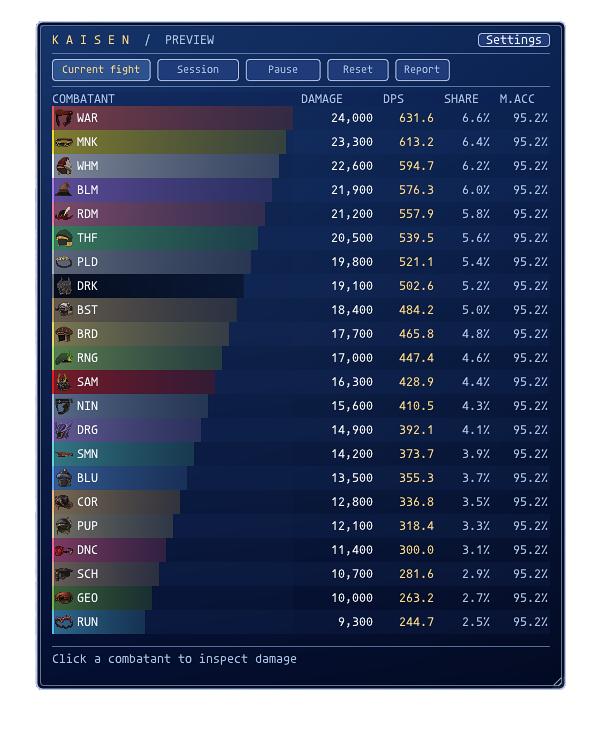

# Kaisen — FFXI Battle Parser

Version 1.0.20 • HorizonXI • Ashita v4

Change in 1.0.20: Report menu sends the selected Current fight or Session top six to party or linkshell, including damage, DPS, share, and melee accuracy. Preview data cannot be reported.

- `/kaisen report party` or `/kaisen report linkshell`: report the top six.
- `/kaisen report party 18`: include up to 18 combatants (also works with linkshell).
- `/kaisen report cancel`: cancel remaining lines.

Reports snapshot current values and send one line every 1.2 seconds. Resetting or zoning cancels remaining lines. No report is sent automatically.

Change in 1.0.19: Preview cycles sample damage every 1.4 seconds to demonstrate smooth bar growth and shrinkage for all jobs. Live combat data is unaffected.

Change in 1.0.18: damage bar lengths ease smoothly in both directions; numeric stats remain immediate.

Change in 1.0.17: drag the bottom-right corner to resize width and height. Size is saved; the roster fills available height. Unlock position / size in Settings to resize. Minimum size is 440 by 180 at normal scale.

Change in 1.0.16: yellower MNK bars and a contrasting charcoal left accent for DRK, retaining its black fill.

Change in 1.0.15: WHM pure white and PLD silver class colors.

Change in 1.0.14: DRK black, SAM red, and PLD white class colors.

Change in 1.0.13: preview includes all 22 jobs, with their icons, class colors, and sample damage. Scroll the roster to see every job.

Change in 1.0.12: distinct crimson DRK damage bars; BLM retains purple.

Change in 1.0.11: matched Renkei blue gradients, window background, separators, and button colors; removed the dark overlay behind the roster.

Change in 1.0.10: reduced toolbar button width, height, padding, and spacing to match its 15% smaller text.

Change in 1.0.9: removed gaps between combatant rows and reduced toolbar label text by 15%.

Change in 1.0.8: removed the dark job-icon backing; native icon alpha now shows the damage bar beneath.

Change in 1.0.7: fixed the ImGui cursor-boundary popup when drawing combatant rows.

Change in 1.0.6: refined navy interior, subtle alternating rows, gradient job
bars with icon backings, consistent active-tab buttons, and right-aligned,
vertically centered statistics. The compact 520px width is retained.

Change in 1.0.5: centered job icons and names vertically. The damage bar now
fills the name/icon cell behind its contents instead of appearing underneath.
The whole name/icon cell is clickable; bar lengths remain relative to the leader.

Change in 1.0.4: removed the status, aggregate damage/DPS/time, current target,
and encounter-count lines above the rankings. Preview is labeled in the title.

Change in 1.0.3: replaces ranking numbers with XIUI's job icons. The default
is XIUI's FFXI set; select Classic or FFXIV-1 in Settings to match a different
XIUI theme. These are the original PNGs, included in the package.

Change in 1.0.2: reduced default width from 650 to 520 pixels (20% narrower),
with tighter columns and shorter/reflowed labels. Font size is unchanged.

Fix in 1.0.1: prevent the damage formatter's Lua replacement-count return value
from being passed as a color to TextColored. Resolves the ui.lua:26 render error
in the roster and damage breakdown. The UI regression test now validates RGBA
argument types, including preview and detail rows.

A standalone Lua damage parser with a blue gradient window, silver borders,
gold headings and job-colored damage bars. No Deeps plugin or other parser is
required. Kaisen can run alongside Renkei.

## Install

1. Extract the `kaisen` folder into the `addons` folder in the Ashita installation
   used by Horizon. The main file must be `addons/kaisen/kaisen.lua`.
2. Enter `/addon load kaisen` in game.
3. Enter `/kaisen preview` to see sample data outside combat. Enter the same
   command again to return to your real totals.
4. Drag the window's background to move it. Use Settings or `/kaisen lock` to
   lock it in place. `/kaisen move 100 160` restores a visible position.

To autoload, add `/addon load kaisen` alongside your other addon load commands
in your active Ashita startup script. Keep all six Lua files and the entire assets folder together.

## What it shows

- Party and alliance damage, sorted from highest to lowest.
- Damage, DPS, percentage of group damage, and melee accuracy in the main list.
- Job-colored bars relative to the highest damage dealer.
- Current encounter and full-session views.
- Click a combatant's name for damage sources, hits, misses, averages and maxima.
- Details include melee/ranged accuracy, melee critical rate, pet damage and
  skillchain damage. Hover a source to see crit, magic-burst and avoidance counts.
- Pet damage is credited to its current party/alliance owner and labeled with
  the pet's name in the source list.
- Skillchains are credited to the closing action's owner and shown separately
  in their breakdown. Additional effects and counter/spikes damage are also
  separate sources. All are included in the displayed damage total.

The eight-row roster scrolls for larger groups. Details have their own scroll
area. Settings control scale, position locking, sample preview and idle timeout.

## How the numbers work

**M.Acc:** normal melee hits / (normal melee hits + misses). Weapon skills,
spells, ranged attacks, pets, skillchains and additional effects never increase
this denominator or numerator. Zero-damage hit messages still count as hits.
Special avoidance messages, including parry, shadows and countered swings, are
shown separately and excluded from M.Acc. Ranged accuracy is separate in details.

**Critical rate:** critical melee hits / all landed melee hits. Magic bursts are
recorded as bursts, not critical hits.

**Hits in a source breakdown:** recorded outcomes, not casts or individual hits
within a multi-hit weapon skill. FFXI generally reports a weapon skill's combined
damage; it cannot reveal the exact hit count from that result. AoE spells may
have multiple outcomes. Barrage/ranged results can also be aggregated by the game.

**DPS:** damage divided by the time from the first to the last recorded combat
outcome, with a one-second minimum per encounter. All players share that same
denominator. It updates with combat events and stays fixed between them. Session
DPS divides total damage by the sum of encounter durations, excluding downtime
between separate fights. Very short samples can be volatile.

**Encounters:** a fight begins on a recognized party damage/attack outcome.
It ends when all recorded targets have reported their defeat, on zoning, or
after 15 seconds without a tracked outcome (configurable 5–60 seconds). Pausing
also closes the current fight. The next outcome starts a new one. Multiple mobs
fought together belong to one encounter; the current view is not a target filter.
Long inactive phases can split one boss fight; increase the timeout if needed.

**Session:** retained across fights and zoning. Reset clears both views. Pausing
or hiding the panel preserves existing totals; hiding does not stop collection.
Switching characters clears totals. Combat data is in memory and is lost on
addon unload or client exit; window preferences are saved.

## Commands

| Command | Effect |
|---|---|
| `/kaisen` | Show the panel and toggle settings |
| `/kaisen preview` | Toggle isolated sample data; real collection continues |
| `/kaisen current` | Show current/last encounter |
| `/kaisen session` | Show accumulated session |
| `/kaisen pause` / `/kaisen resume` | Pause/resume recording |
| `/kaisen reset` | Immediately clear all combat statistics |
| `/kaisen hide` / `/kaisen show` | Hide/show UI without stopping recording |
| `/kaisen lock` | Toggle position lock |
| `/kaisen icons ffxi` | Use the XIUI FFXI job icons (default) |
| `/kaisen icons classic` | Use the XIUI Classic job icons |
| `/kaisen icons ffxiv` | Use the XIUI FFXIV-1 job icons |
| `/kaisen scale 1.2` | UI scale, 0.7–1.8 |
| `/kaisen idle 30` | Encounter idle cutoff, 5–60 seconds |
| `/kaisen move 100 160` | Set window position |
| `/kaisen help` | Display command help |
| `/addon unload kaisen` | Unload and save window preferences |

The on-screen Reset button asks before clearing the session. The reset command
clears immediately. No command sends results to party chat or automates combat.

## Compatibility and limits

This release targets **Ashita v4 on HorizonXI**, not Windower or Ashita v3.
It uses native ImGui panels and the Ashita font, with bundled XIUI job-icon
artwork. No XIUI installation or extra DLL plugin is required. Icons scale with
the UI. Unknown jobs show a question mark; failed texture loads fall back to
job abbreviations. Copy the assets folder when updating.

The parser reads incoming combat packets and does not alter/block them.
It sees only combat events delivered to your client while loaded and unpaused.
Out-of-range events, damage-over-time ticks without attributable actor data,
unknown/custom server messages and pet actions whose owner is unavailable can
be absent. Healing, damage taken and enmity are not tracked. Some pet ability
names appear as numeric IDs; their damage still counts. English action names
are read from client resources when available.

All Lua files passed LuaJIT syntax checks. Synthetic packet and mocked-host
tests covered multi-target/multi-swing accounting, truncated packets, accuracy,
crit/burst separation, pets, counter ownership, skillchains, duplicate handling,
encounter boundaries, session DPS, pause/reset, preview and UI stack balance.

**Not yet tested or visually verified in a live FFXI client.** Offline checks do
not certify every Ashita build or Horizon combat variation. If you encounter an
error, send the exact Ashita error text and what happened immediately before it.

## Files

- `kaisen.lua`: Ashita events, commands, ownership and settings.
- `packet.lua`: bounds-checked action packet decoder.
- `engine.lua`: combat classification, encounters and statistics.
- `ui.lua`: rankings, drill-down, preview and settings.
- `theme.lua`: FFXI-inspired panel styling.
- `jobicons.lua`: cached D3D job textures and text fallback.
- `assets/jobs/`: original XIUI job-icon sets and accompanying credits.

See `NOTICE.md` and `LICENSE` for sources and licensing.

## Version 1.0.21 — Skillchain damage setting

Settings now includes **Include skillchain damage**, off by default for new installs and existing settings without this option. The choice is saved. Toggling immediately updates current and session damage totals, DPS, shares, pet totals, breakdowns and subsequently generated reports. Recorded skillchain damage is retained internally so turning it back on restores it. Weapon skill damage, additional effects and magic bursts remain counted.
